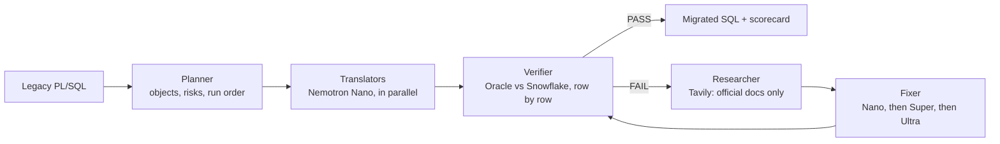

# LakeShift

**Migrate legacy Oracle PL/SQL to Snowflake SQL, and prove every result row by row.**

LakeShift reads legacy Oracle ETL code (procedures, packages, cursor loops, hierarchical
queries), translates it to Snowflake SQL with NVIDIA Nemotron models on Nebius Token Factory,
then runs both versions on the same data and compares every row. Nothing is marked done until
Snowflake produces exactly what Oracle produces.

**Live demo:** https://lakeshift-nebius-nemotron.streamlit.app/

## Why

Most migration tools translate code and hope. Teams then spend weeks finding the cases where
Oracle and Snowflake behave differently: `''` is NULL in Oracle but not in Snowflake,
`MONTHS_BETWEEN` and date arithmetic differ, cursor loops carry hidden state, `CONNECT BY` has
no direct equivalent. LakeShift treats the original Oracle database as the answer key and only
accepts a translation that matches it exactly.

## How it works




1. **Planner** finds every object, what it reads and writes, the migration risks, and the order
   to run them in.
2. **Translators** convert each object to one Snowflake `SELECT`, in parallel.
3. **Verifier** runs the untouched legacy code in Oracle and the translation in Snowflake, then
   compares the full result sets. It also replays day-2 scenarios (changed and deleted
   customers) for incremental loads.
4. **Researcher** looks up the failing behaviour in docs.oracle.com and docs.snowflake.com
   through Tavily, and every source is cited in the scorecard.
5. **Fixer** sends the verifier's evidence back to a model and climbs a ladder only when
   needed: Nemotron 3 Nano, then Super, then Ultra.

## Results (latest run)

| Object | Oracle feature | Result | Solved by |
|---|---|---|---|
| `load_stg_customers` | `NVL`, `DECODE`, `TRUNC(date,'MM')`, `''` vs NULL | PASS | Super |
| `load_dim_customer` | `MERGE` with day-2 changes and deletes | PASS | Nano |
| `load_fct_sales` | aggregates and ranking | PASS | first translation |
| `load_customer_points` | package + cursor loop with running, capped balance | PASS | Ultra |
| `load_referral_tree` | `CONNECT BY`, `SYS_CONNECT_BY_PATH`, `CONNECT_BY_ISLEAF` | PASS | Super |
| `load_order_gaps` | `LAG`, date subtraction, `MONTHS_BETWEEN`, `NUMTODSINTERVAL` | PASS | Nano |

6 of 6 objects proven equal, 5,685 rows compared, about 65k tokens per full run.

## Cost

Serverless Nebius Token Factory, priced per token:

| Model | Input / output per 1M tokens | Role |
|---|---|---|
| Nemotron 3 Nano 30B | $0.06 / $0.24 | every first translation and most fixes |
| Nemotron 3 Super 120B | $0.30 / $0.90 | second attempt |
| Nemotron 3 Ultra 550B | $1.00 / $3.00 | only the hardest objects |

A full run of all six objects costs **under $0.07** even if every token is priced at the output
rate. The cheap model does most of the work, and the large model is called only when the proof
says it is needed.

## Why Nebius + Nemotron

**Cost of the latest run** (worst-case estimate: every token priced at the output rate):

| Model | Tokens | Worst-case cost |
|---|---|---|
| Nemotron 3 Nano | 40,698 | $0.0098 |
| Nemotron 3 Super | 9,721 | $0.0087 |
| Nemotron 3 Ultra | 15,022 | $0.0451 |
| **Total** | **65,441** | **~$0.064** |

Sending the same 65,441 tokens to Ultra alone would cost ~$0.196, so the ladder is about
**3x cheaper**, and the big model was needed for only one object.

**Ease of setup.** Token Factory is OpenAI-compatible, so the standard client works unchanged:

```python
from openai import OpenAI
client = OpenAI(base_url="https://api.tokenfactory.nebius.com/v1/", api_key=NEBIUS_API_KEY)
reply = client.chat.completions.create(model="nvidia/NVIDIA-Nemotron-3-Nano-30B-A3B", messages=msgs)
```

- Open NVIDIA models in three sizes; switching model is changing one string.
- Serverless and pay per token: no GPUs to provision or manage.
- One API key for every model.
- Dedicated endpoints for enterprise isolation, with the same code.

## Nebius features used

- **Serverless Token Factory:** pay per token, OpenAI-compatible, one API key for every model.
- **Model ladder:** Nemotron 3 Nano writes first drafts; Super and then Ultra are called only when the row-by-row proof fails.
- **Prompt caching:** the fixed instructions come first in every call, so Token Factory serves them from cache (Super $0.06 instead of $0.30, Ultra $0.12 instead of $1.00 per 1M cached input tokens). `migrated/usage.json` records cached tokens per model.
- **Structured output (opt-in):** translate and fix calls can use a JSON schema `{"sql", "notes"}` with `NEBIUS_STRUCTURED=1`. It works on all three models, but a full run scored 4/6 with it on and 6/6 with it off (long procedures squeezed into one JSON string lost quotes and line breaks), so it is off by default.
- **Fixer hints from real errors:** when Snowflake returns an opaque "internal error" on a recursive query, the fixer tells the model to keep subqueries out of the recursive CTE. This took `load_referral_tree` from unsolved to PASS.
- **Reasoning effort:** `low` for Nano, `medium` for Super, `high` for Ultra (override with `NEBIUS_EFFORT_NANO`, `NEBIUS_EFFORT_SUPER`, `NEBIUS_EFFORT_ULTRA`). Reasoning tokens are recorded per model.
- **Dedicated endpoint (optional):** set `NEBIUS_DEDICATED_BASE_URL` to move Nano onto reserved capacity with the same code.
- **Tavily search:** the fixer cites official documentation before each repair.

## Where this applies

- **Banking and insurance:** loyalty and wallet balances, account hierarchies, regulatory reports where a wrong number is a compliance issue.
- **Retail and e-commerce:** rewards points, churn and reorder analytics such as order gaps.
- **Telecom:** customer hierarchies and usage rollups.
- **Healthcare and public sector:** data cannot leave on-prem; masking plus local verification keep it there.
- **Manufacturing:** bill-of-materials hierarchies written with `CONNECT BY`.
- **Consultancies and SIs** running Oracle-to-Snowflake programmes: the row-by-row proof report is the sign-off artifact.

## Security

- **Private source database.** In private mode, Oracle runs in Docker on a private network,
  bound to `127.0.0.1` only (`docker-compose.yml`). It is never reachable from outside the machine.
- **Synthetic judge demo database.** The only Oracle reachable from the internet is a separate
  demo instance on a Google Cloud VM. It holds only synthetic sample data, uses a non-admin demo
  user, and live runs need a judge access code and are capped per day.
- **No customer data sent to models.** Text values in verifier reports are masked before any
  model call (`lakeshift/privacy.py`). Models see shapes like `<text#a1b2c3 len=9 Mixed>`,
  never names or emails. Numbers, dates and empty strings stay visible because they carry the
  semantics the models need.
- **Restricted research.** Tavily searches are limited to official Oracle and Snowflake
  documentation, and every source used is logged.
- **Secrets stay local** in `.env`, which is git-ignored. The hosted demo holds only an
  inference key.
- **Enterprise option.** For regulated workloads, the same code can point at a Nebius
  dedicated endpoint for isolated capacity. Only the base URL and model name change.

### Production design: bring the code to the data

With real data, the hosted page never connects to Oracle. In production it would queue a job (for example in a
Snowflake table); a worker next to the database picks it up, runs the Oracle side locally and
writes back only the PASS/FAIL scorecard. Oracle accepts no outside connection and no customer
rows leave the site. Options considered:

- Opening port 1521 to the internet: never for real data. The hackathon demo database holds
  only synthetic sample rows (see "Cloud demo database").
- A VPN such as Tailscale: fine for teams, but hosted apps cannot join it.
- Cloudflare Tunnel with Cloudflare Access: outbound-only and login-gated, but more moving parts.

### Demo modes

1. **Private mode.** Oracle runs on the laptop, bound to `127.0.0.1` on a private Docker
   network. This is how the run was recorded and how a team would use LakeShift on real data.
2. **Judge demo.** The hosted Streamlit page replays the last verified run, makes live Nemotron
   calls, and can run the full live migration against a synthetic-data Oracle on a Google Cloud
   VM, guarded by a judge access code and a daily run cap.

### Cloud demo database

For judging, a throwaway Oracle with synthetic data runs on a Google Cloud VM (`e2-medium`, `asia-south1`)
(setup: [`docs/cloud-oracle-setup.md`](docs/cloud-oracle-setup.md)). Configure it with these
variables in `.env` or Streamlit secrets; all have local defaults, so local use is unchanged.

| Variable | Default | Purpose |
|---|---|---|
| `ORACLE_HOST` | `127.0.0.1` | Oracle host |
| `ORACLE_PORT` | `1521` | Oracle port |
| `ORACLE_USER` | `system` | Oracle user (use a dedicated demo user in the cloud) |
| `ORACLE_PASSWORD` | (required) | Oracle password |
| `ORACLE_SERVICE` | `FREEPDB1` | Service name |
| `JUDGE_ACCESS_CODE` | (none) | If set, the live run button asks for this code |
| `LIVE_RUNS_PER_DAY` | `10` | Daily cap on live runs |

Only one live run happens at a time, because each run resets the same demo tables. While it runs, the page shows a progress bar with the time left and a plain-words activity feed. Anyone who opens the page meanwhile sees the same progress, and a stuck run is cleared automatically after 10 minutes.

Live runs work in a scratch copy, so the committed `migrated/` results shown on the page are
never overwritten.

## Dedicated endpoint (optional)

LakeShift runs on serverless Token Factory by default. Nemotron 3 Nano can also run on a
**dedicated endpoint** (reserved GPU, fixed region for data residency, no rate limits, billed per
GPU-minute while ready). Only two environment variables change; Super and Ultra stay serverless:

```powershell
$env:NEBIUS_NANO_MODEL = "<routing key>"
$env:NEBIUS_DEDICATED_BASE_URL = "https://api.tokenfactory.nebius.com/v1/"
python -m lakeshift.bench --target dedicated --runs 1
```

`python -m lakeshift.bench --target serverless|dedicated [--runs N] [--limit N]` times the Nano
translation step (latency, time to first token, tokens/s) and writes `migrated/bench_<target>.json`,
which the app shows in the **Dedicated endpoint** tab. Step-by-step guide and cost:
[docs/dedicated-endpoint.md](docs/dedicated-endpoint.md).

**Measured on Oct 26, 2026** (Nano translating all 6 objects, same prompts, 1 run each):

| | Serverless | Dedicated (1x H100, eu-north1) |
|---|---|---|
| Median tokens/s | 124 | **307 (about 2.5x)** |
| Median time per object | 12.1 s | **8.2 s** |
| Median time to first token | 0.82 s | **0.73 s** |
| Cold start | none | 32 s on the first call |

The endpoint was stopped right after the benchmark. In the app, **Run migration on dedicated endpoint**
is live only while `NEBIUS_DEDICATED_BASE_URL` and a `dedicated/...` `NEBIUS_NANO_MODEL` are set, and
greyed out otherwise (as on the hosted page). Do not put these in Streamlit secrets.
