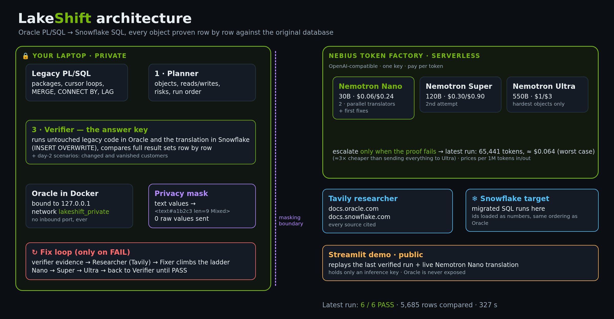
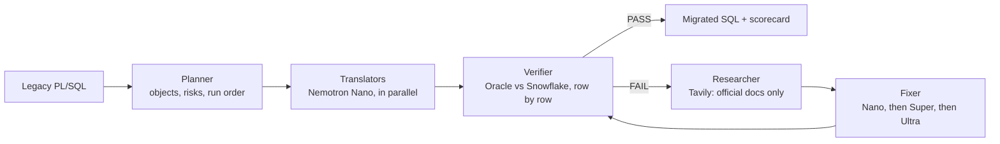

# LakeShift

**Migrate legacy Oracle PL/SQL to Snowflake SQL, and prove every result row by row.**

LakeShift reads legacy Oracle ETL code (procedures, packages, cursor loops, hierarchical
queries), translates it to Snowflake SQL with NVIDIA Nemotron models on Nebius Token Factory,
then runs both versions on the same data and compares every row. Nothing is marked done until
Snowflake produces exactly what Oracle produces.

**Live demo:** https://lakeshift-nebius-nemotron.streamlit.app/

## Why

Most migration tools translate code and hope. Teams then spend weeks finding the cases where
Oracle and Snowflake behave differently: `''` is NULL in Oracle but not in Snowflake,
`MONTHS_BETWEEN` and date arithmetic differ, cursor loops carry hidden state, `CONNECT BY` has
no direct equivalent. LakeShift treats the original Oracle database as the answer key and only
accepts a translation that matches it exactly.

## How it works





1. **Planner** finds every object, what it reads and writes, the migration risks, and the order
   to run them in.
2. **Translators** convert each object to one Snowflake `SELECT`, in parallel.
3. **Verifier** runs the untouched legacy code in Oracle and the translation in Snowflake, then
   compares the full result sets. It also replays day-2 scenarios (changed and deleted
   customers) for incremental loads.
4. **Researcher** looks up the failing behaviour in docs.oracle.com and docs.snowflake.com
   through Tavily, and every source is cited in the scorecard.
5. **Fixer** sends the verifier's evidence back to a model and climbs a ladder only when
   needed: Nemotron 3 Nano, then Super, then Ultra.

## Results (latest run)

| Object | Oracle feature | Result | Solved by |
|---|---|---|---|
| `load_stg_customers` | `NVL`, `DECODE`, `TRUNC(date,'MM')`, `''` vs NULL | PASS | Super |
| `load_dim_customer` | `MERGE` with day-2 changes and deletes | PASS | Nano |
| `load_fct_sales` | aggregates and ranking | PASS | first translation |
| `load_customer_points` | package + cursor loop with running, capped balance | PASS | Ultra |
| `load_referral_tree` | `CONNECT BY`, `SYS_CONNECT_BY_PATH`, `CONNECT_BY_ISLEAF` | PASS | Super |
| `load_order_gaps` | `LAG`, date subtraction, `MONTHS_BETWEEN`, `NUMTODSINTERVAL` | PASS | Nano |

6 of 6 objects proven equal, 5,685 rows compared, about 65k tokens per full run.

## Cost

Serverless Nebius Token Factory, priced per token:

| Model | Input / output per 1M tokens | Role |
|---|---|---|
| Nemotron 3 Nano 30B | $0.06 / $0.24 | every first translation and most fixes |
| Nemotron 3 Super 120B | $0.30 / $0.90 | second attempt |
| Nemotron 3 Ultra 550B | $1.00 / $3.00 | only the hardest objects |

A full run of all six objects costs **under $0.07** even if every token is priced at the output
rate. The cheap model does most of the work, and the large model is called only when the proof
says it is needed.

## Why Nebius + Nemotron

**Cost of the latest run** (worst-case estimate: every token priced at the output rate):

| Model | Tokens | Worst-case cost |
|---|---|---|
| Nemotron 3 Nano | 40,698 | $0.0098 |
| Nemotron 3 Super | 9,721 | $0.0087 |
| Nemotron 3 Ultra | 15,022 | $0.0451 |
| **Total** | **65,441** | **~$0.064** |

Sending the same 65,441 tokens to Ultra alone would cost ~$0.196, so the ladder is about
**3x cheaper**, and the big model was needed for only one object.

**Ease of setup.** Token Factory is OpenAI-compatible, so the standard client works unchanged:

```python
from openai import OpenAI
client = OpenAI(base_url="https://api.tokenfactory.nebius.com/v1/", api_key=NEBIUS_API_KEY)
reply = client.chat.completions.create(model="nvidia/NVIDIA-Nemotron-3-Nano-30B-A3B", messages=msgs)
```

- Open NVIDIA models in three sizes; switching model is changing one string.
- Serverless and pay per token: no GPUs to provision or manage.
- One API key for every model.
- Dedicated endpoints for enterprise isolation, with the same code.

## Where this applies

- **Banking and insurance:** loyalty and wallet balances, account hierarchies, regulatory reports where a wrong number is a compliance issue.
- **Retail and e-commerce:** rewards points, churn and reorder analytics such as order gaps.
- **Telecom:** customer hierarchies and usage rollups.
- **Healthcare and public sector:** data cannot leave on-prem; masking plus local verification keep it there.
- **Manufacturing:** bill-of-materials hierarchies written with `CONNECT BY`.
- **Consultancies and SIs** running Oracle-to-Snowflake programmes: the row-by-row proof report is the sign-off artifact.

## Security

- **Private source database.** Oracle runs in Docker on a private network, bound to
  `127.0.0.1` only (`docker-compose.yml`). It is never reachable from outside the machine.
- **No customer data sent to models.** Text values in verifier reports are masked before any
  model call (`lakeshift/privacy.py`). Models see shapes like `<text#a1b2c3 len=9 Mixed>`,
  never names or emails. Numbers, dates and empty strings stay visible because they carry the
  semantics the models need.
- **Restricted research.** Tavily searches are limited to official Oracle and Snowflake
  documentation, and every source used is logged.
- **Secrets stay local** in `.env`, which is git-ignored. The hosted demo holds only an
  inference key.
- **Enterprise option.** For regulated workloads, the same code can point at a Nebius
  dedicated endpoint for isolated capacity. Only the base URL and model name change.

### Production design: bring the code to the data

The hosted page never connects to Oracle. In production it would queue a job (for example in a
Snowflake table); a worker next to the database picks it up, runs the Oracle side locally and
writes back only the PASS/FAIL scorecard. Oracle accepts no outside connection and no customer
rows leave the site. Options considered:

- Opening port 1521 to the internet: never.
- A VPN such as Tailscale: fine for teams, but hosted apps cannot join it.
- Cloudflare Tunnel with Cloudflare Access: outbound-only and login-gated, but more moving parts.

### Demo modes

The full live pipeline runs where the private Oracle lives (recorded on the laptop). The hosted
page replays the last verified run and makes live Nemotron calls. The Oracle database is
intentionally never exposed.